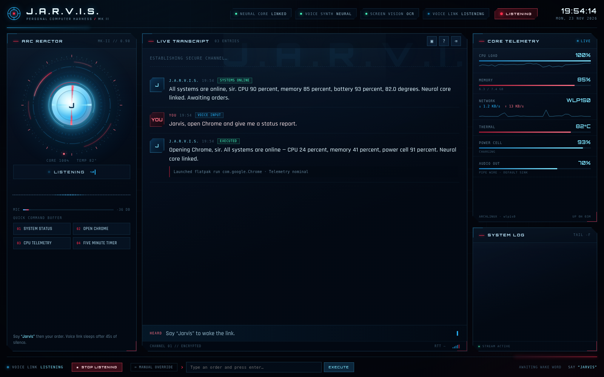

# J.A.R.V.I.S.

**A voice-only computer harness for Linux.** Talk to your machine: it opens what
you name, plays what you ask for, reads your screen, and clicks and types for you.
Blue-and-red Stark-style HUD, local-first, one `./start.sh`.

<!-- Screenshot: docs/preview.png -->


> Say **“Jarvis”**, then the order. Everything else is optional.

---

## Why

Voice assistants are either cloud products that can't touch your desktop, or
desktop macros with no idea what's on screen. JARVIS sits in between: a local
control harness with real PC actions, a live read of your display, and a bounded
computer-use agent that can actually drive the window in front of you.

- **Voice only.** Wake word, spoken replies, no mouse required.
- **Local first.** Binds to `127.0.0.1`, synthesises speech on the CPU, OCRs
  on-device, and keeps audio off third-party servers.
- **Bounded agency.** The agent runs a fixed step budget, shows every action, and
  anything destructive needs a spoken *"yes"*.
- **Made to look like the films**, because a HUD you enjoy using is a HUD you use.

## Features

| Area | What it does |
| --- | --- |
| Apps & files | Opens apps by name, projects in VS Code, any file or folder a fuzzy search finds, Chrome bookmarks, websites — falling back to a web search |
| Web & video | Resolves the first YouTube match and *plays the video*, not the results page |
| System | Volume, brightness, media transport, Wi-Fi, Bluetooth, do-not-disturb, night light, screenshots, lock, suspend, restart, power off |
| Telemetry | CPU, memory, disk, network, thermal, battery, audio, uptime — spoken and on screen |
| Screen vision | Continuous local OCR of your display for “what's on my screen” and “fix this error”; answers alongside your work, no screenshots saved |
| Agent (CUA) | Clicks, types, scrolls and navigates real windows through the [CUA driver](https://github.com/trycua/cua), with a visible step trace |
| Utility | Timers, notes, arithmetic, weather, time and date |
| Control | **STOP LISTENING** button and voice, confirmation prompts, manual override |

## Requirements

- Arch/GNOME on Wayland or X11 (other desktops work for most actions)
- Python 3.11+
- Google Chrome — it owns the speech-recognition API
- `wpctl`, `busctl`, `nmcli`, `rfkill`, `gsettings`, `loginctl`, `xdg-open`
- A DeepSeek API key for the neural core (optional; local commands still work)

## Install

```bash
git clone https://github.com/<you>/jarvis-harness.git
cd jarvis-harness
./scripts/setup-assets.sh     # voice engine + voices + CUA driver
./start.sh
```

`start.sh` creates a virtualenv, installs Python dependencies, serves on
`127.0.0.1:8765`, and opens Chrome. Click **ENGAGE VOICE LINK** once and allow
the microphone — Chrome requires that single click before continuous recognition.

Give it a key (either source works, the first match wins):

```bash
export DEEPSEEK_API_KEY=sk-...        # or keep it in ~/.dsh/.credentials.yaml
```

## Usage

1. Click **ENGAGE VOICE LINK**, allow the mic.
2. Say **“Jarvis”**, then an order: *“Jarvis, open Chrome”*, *“Jarvis, play Believer
   on YouTube”*, *“Jarvis, what's on my screen”*.
3. Follow-ups need no wake word for 45 seconds — the footer shows the countdown.
4. **STOP LISTENING** (or *“Jarvis, stop listening”*) mutes the mic, cuts speech and halts the agent.

Full list: [`docs/commands.md`](docs/commands.md).

## How it works

```
voice → wake gate → intent router → action adapter → spoken reply
                       ↓ unknown
                  neural core (DeepSeek) ──┬─→ chat / screen answer
                                          └─→ agent loop → CUA driver → window
```

1. **Router.** A deterministic rule engine handles the frequent, latency-sensitive
   commands. Nothing leaves the machine for those.
2. **Neural core.** Anything it can't place goes to DeepSeek, which may answer,
   return a machine action, or ask for screen context.
3. **Screen read.** A background watcher OCRs the display while the link is live.
   Answers use that buffer, so they're instant and stateless.
4. **Agent.** For real interaction it resolves a window, reads its accessibility
   tree, asks for one action at a time, executes, and verifies.

Details: [`docs/architecture.md`](docs/architecture.md) ·
[`docs/agent.md`](docs/agent.md).

## Configuration

`data/settings.json` (created on demand, git-ignored):

```json
{
  "voice": "en-GB-RyanNeural",
  "tts_engine": "piper",
  "piper_model": "tools/piper/voices/en_GB-alan-medium.onnx",
  "awake_seconds": 45,
  "wake_words": ["jarvis", "jervis", "jarvus", "parvez"],
  "weather_location": "Mumbai",
  "llm_enabled": true
}
```

Delete the file to restore defaults. Hinglish orders (*“chrome kholo”*, *“battery
kitni hai”*) are understood while replies stay English unless you switch voice
and language in settings.

## Privacy & safety

- HTTP server binds to localhost; POSTs are origin-checked.
- `shutdown`, `restart`, `suspend` and `shell` require verbal confirmation.
- Speech synthesis is local by default; recognition uses Chrome's speech service
  and the neural core uses DeepSeek, so both need a network.
- Screen OCR happens on-device. Extracted text is only sent when you ask for
  screen help.
- No analytics, accounts or databases. Read [`docs/privacy.md`](docs/privacy.md).

## Troubleshooting

See [`docs/troubleshooting.md`](docs/troubleshooting.md). Quick checks:

| Symptom | Fix |
| --- | --- |
| Mic does nothing | Chrome site settings → Microphone → Allow, reload |
| Says PAUSED | Press **RESUME** in the footer |
| Agent finds no window | Start the app through JARVIS, not from the dash |
| Port busy | `JARVIS_PORT=8766 ./start.sh` |

## Development

```bash
.venv/bin/python -m unittest discover -s tests -v
```

No framework, no bundler, no CDN: stdlib HTTP server, vanilla HTML/CSS/JS.
`docs/architecture.md` maps every file. Contributions welcome — see
[`CONTRIBUTING.md`](CONTRIBUTING.md).

## License

MIT — see [`LICENSE`](LICENSE). Bundled third-party work is listed in
[`THIRD_PARTY.md`](THIRD_PARTY.md).

---

*“Sometimes you gotta run before you can walk.”*
